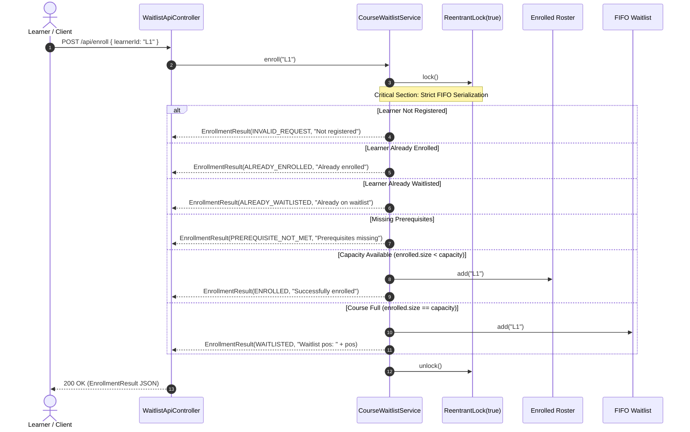
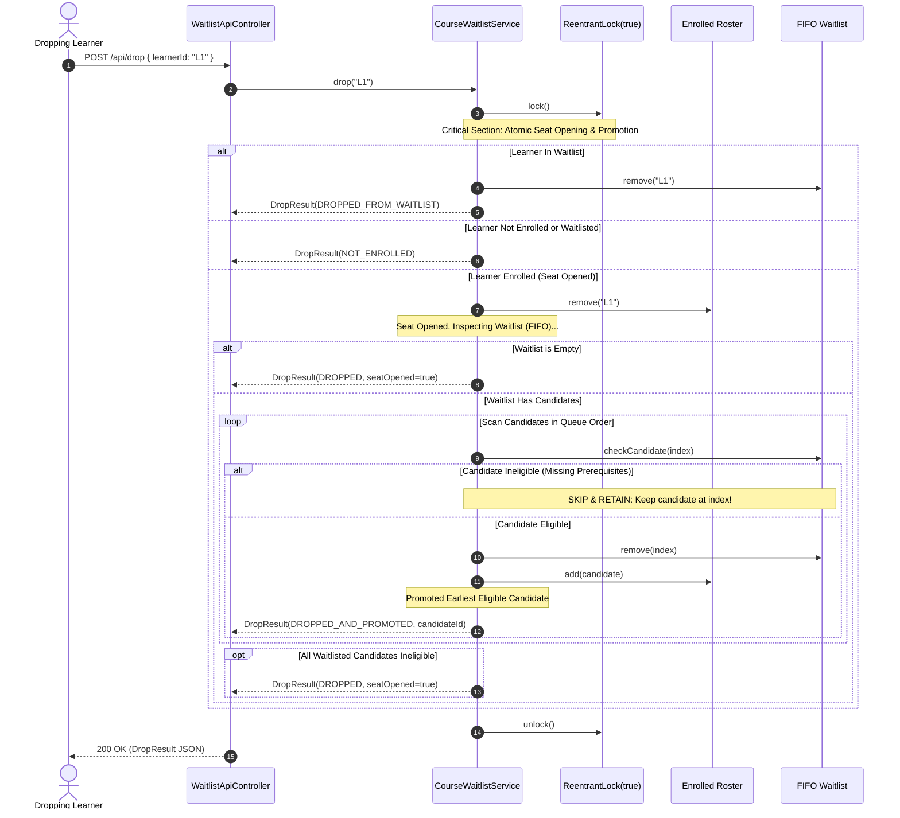

# Course Waitlist Service — Java Fullstack Design Specification

## 1. System Boundary & Architecture Overview

The **KiVO Course Waitlist Service** is a high-reliability, thread-safe service slice implementing **course enrollment, dropping, and FIFO waitlist promotion** for a single course offering.

The implementation is built as a **Java 25 / Spring Boot 4.1.2 Fullstack Application**, featuring:
- High-throughput execution powered by Java 25 Virtual Threads (`spring.threads.virtual.enabled=true`).
- A high-concurrency Java service layer guarded by fair re-entrant locking (`ReentrantLock(true)`).
- A RESTful HTTP API conforming to **OpenAPI 3.0.3** with automated build-time interface code-generation (`openapi-generator-maven-plugin`).
- RFC 7807 `ProblemDetail` standardized HTTP error responses via `@RestControllerAdvice`.
- An interactive single-page dashboard served directly from Spring Boot (`src/main/resources/static/`).
- Comprehensive automated verification spanning unit tests, virtual thread concurrency tests, and Behaviour-Driven Development (BDD) scenario specifications.

```
+------------------------------------------------------------------------+
|                     Client Tier (Browser / REST Clients)               |
+------------------------------------------------------------------------+
           |                                            |
      GET / (HTML/JS/CSS)                        POST /api/enroll, /drop
           v                                            v
+------------------------------------------------------------------------+
|                 WaitlistApiController (Spring MVC REST)                |
+------------------------------------------------------------------------+
                                   |
                      DTO Validation (@Valid)
                                   v
+------------------------------------------------------------------------+
|                      CourseWaitlistService                             |
|          Guarded by Fair ReentrantLock (Strict FIFO Ordering)          |
+------------------------------------------------------------------------+
      |                           |                           |
      v                           v                           v
+------------------+    +-------------------+    +--------------------+
| Enrolled Roster  |    | FIFO Waitlist     |    | Learner Repository |
| List<String>     |    | List<String>      |    | ConcurrentHashMap  |
+------------------+    +-------------------+    +--------------------+
```

---

## 2. Java Domain Model & Core Invariants

### 2.1 Domain Entities

```java
// Course Offering
public class CourseOffering {
    private final String id;
    private final String title;
    private final int capacity;           // Must be > 0
    private final Set<String> prerequisites;
}

// Learner
public class Learner {
    private final String id;
    private final String name;
    private final Set<String> completedCourses;
    public boolean hasPrerequisites(Set<String> required);
}
```

### 2.2 System Invariants

1. **Capacity Invariant**: `0 <= enrolled.size() <= capacity` at all times. No operation or concurrent race may cause active enrollments to exceed configured capacity.
2. **Mutual Exclusion Invariant**: For any learner $L$:
   $$\text{enrolled} \cap \text{waitlist} = \emptyset$$
   A learner can occupy exactly one state: `enrolled`, `waitlisted`, or `unregistered`.
3. **Queue Seniority Invariant**: Waitlist order is strict FIFO (arrival order). Duplicate enrollment requests by an already waitlisted learner return `ALREADY_WAITLISTED` without modifying their queue position.
4. **Prerequisite Invariant**: A learner cannot enter `enrolled` (via direct registration or promotion) unless:
   $$\text{prerequisites} \subseteq \text{learner.completedCourses}$$

---

## 3. Prerequisite & Waitlist Eligibility Policy

### Policy Decision: "Skip and Retain"
In academic course registration, students frequently queue for advanced courses while awaiting final grades for prerequisites. Ejecting an ineligible student from the waitlist when a seat opens is punitive and administratively burdensome.

Under our **Skip-and-Retain Policy**:
1. **At Drop / Promotion Time**:
   - When an enrolled seat opens, the service iterates through the waitlist from head to tail (FIFO).
   - The **first learner who satisfies all prerequisites** is promoted to enrolled status and removed from the waitlist.
   - Any learner ahead of them who is currently ineligible is **skipped but retained** at their exact queue index.
   - If that skipped learner later completes their prerequisite before a subsequent seat opens, their priority tenure is fully preserved.
2. **At Initial Enrollment Time**:
   - If capacity is available and prerequisites are missing: Rejected immediately (`PREREQUISITE_NOT_MET`).
   - If capacity is full and prerequisites are missing: Rejected immediately (`PREREQUISITE_NOT_MET`).

### 3.1 Enrollment Sequence Flow



### 3.2 Drop & Skip-and-Retain Promotion Sequence Flow



---

## 4. Concurrency & Synchronization Model

### The Fair Lock Strategy
In high-throughput registration events (e.g., class registration opening at 8:00 AM), thousands of concurrent requests strike the server within milliseconds.

To guarantee ACID properties and deterministic FIFO queue placement without a database:
- We utilize `java.util.concurrent.locks.ReentrantLock(true)` (fair lock).
- When multiple threads contend for the lock, the JVM grants acquisition in order of thread arrival.
- All mutating operations (`enroll`, `drop`, `reset`, and `getSnapshot`) execute inside `try { lock.lock(); ... } finally { lock.unlock(); }` blocks.
- This prevents race conditions where two threads observe `availableSeats = 1` and both enroll, causing over-subscription.

---

## 5. REST API & OpenAPI 3.0 Mapping

The complete contract is defined in [openapi.yaml](file:///Users/veera/work/code/interview/course-waitlist-service/openapi.yaml).

| Method | Endpoint | Request Body | Response Body | Description |
| :--- | :--- | :--- | :--- | :--- |
| `GET` | `/api/offering` | *None* | `OfferingSnapshot` | Real-time capacity, enrolled count, seat lists, waitlist queue. |
| `GET` | `/api/learners` | *None* | `List<Learner>` | List of all registered learners and completed prerequisites. |
| `POST` | `/api/learners` | `RegisterLearnerRequest` | `Learner` | Registers or updates a learner profile. |
| `POST` | `/api/enroll` | `EnrollRequest` (`{ learnerId }`) | `EnrollmentResult` | Attempts enrollment; returns `ENROLLED`, `WAITLISTED`, etc. |
| `POST` | `/api/drop` | `DropRequest` (`{ learnerId }`) | `DropResult` | Drops enrolled or waitlisted learner; triggers auto-promotion. |
| `POST` | `/api/reset` | *None* | `OfferingSnapshot` | Resets offering to default baseline for demo/testing. |

---

## 6. Architectural Tradeoffs

| Architecture Choice | Alternative Considered | Selected Rationale |
| :--- | :--- | :--- |
| **Java 25 + Spring Boot 4.1.2 + Virtual Threads** | Lightweight CLI / Node.js | Modern high-throughput enterprise backend with lightweight virtual threads, robust type safety, native concurrency primitives, and built-in REST support. |
| **OpenAPI Interface Generation** | Manually written controllers / DTOs | Single-source-of-truth contract (`openapi.yaml`) generates the controller interfaces and models during Maven build, eliminating contract drift. |
| **Fair ReentrantLock** | Synchronized blocks / AtomicInteger | Fair locks prevent thread starvation and guarantee exact chronological ordering during contention spikes across virtual threads. |
| **Skip-and-Retain** | Skip-and-Eject | Protects student queue tenure when prerequisite completion verification is pending. |
| **Embedded Static SPA** | Separate React/Node frontend | Enables zero-configuration single-command execution (`./mvnw spring-boot:run`) without Node/npm build dependencies. |
| **OpenAPI 3.0.3 Contract** | Ad-hoc Markdown documentation | Provides a machine-readable specification ready for client SDK generation and automated contract testing. |
